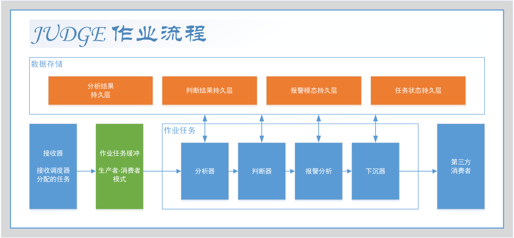

# Core Concepts - 核心概念

## 总览

Judge 是一个面向数据评价的调度框架。一次完整的数据评价过程，可以理解为从外部触发开始，
经过数据分析、分析结果判断、结果可视化、报警状态维护，最后将任务数据下沉到下游系统的过程。

在这个过程中，Judge 重点封装 `数据分析` 和 `分析结果评价` 两个环节，
并为这些环节提供任务调度、状态跟踪、结果持久化、报警模态维护和结果下沉能力。
因此，Judge 不只适用于预测性维护场景，也可以用于搭建规则引擎、数据质量评价系统、数据监控系统等。

在预测性维护业务中，Judge 通常位于数据采集、数据统计等服务之后。它接收或查询上游已经采集、整理的数据，
按照部件配置完成评价，并将结果下沉至预警服务、通知服务、评分服务、报告服务等下游系统。

在 Judge 中，这些过程被拆分为一组相互协作的核心对象：



`部件` 是配置与执行的核心单元，`任务` 是一次作业执行的实例。
驱动器负责触发部件，分析器、判断器和可视化器按照配置顺序依次执行，并将中间结果和最终结果写入任务。
可视化结束后，系统会根据部件当前裁决结果和报警设置维护报警模态、当前报警和报警历史。
任务执行结束前，系统会将任务本身、任务事件、分析结果、判断结果、可视化数据以及报警模态快照组合成下沉信息，
交由下沉器处理。

## 部件

部件对应实体类 `Section`，是 Judge 中组织作业配置的基础对象。
一个部件通常代表一条独立的数据评价链路，例如一类设备、一组业务指标，或一个特定的数据分析场景。

从评价模型看，部件是 Judge 的最小评价单元。
部件可以是实际存在的物理对象，如齿轮、主轴、服务器等；也可以是虚拟的业务指标，如轴承温度、磁盘使用率等。
Judge 以部件为中心维护数据评价作业的触发规则、数据分析规则、分析结果评价规则、结果可视化规则、报警规则和结果下沉规则。

`Section` 包含以下主要字段：

| 字段      | 说明                               |
|-----------|------------------------------------|
| `key`     | 部件的主键。                       |
| `name`    | 部件名称，用于标识部件的业务含义。 |
| `enabled` | 部件是否启用。                     |
| `remark`  | 部件备注。                         |

一个部件可以关联多个分析器、多个判断器和多个可视化器。
分析器、判断器和可视化器都通过各自的信息对象保存 `sectionKey`，以表示它们归属于哪个部件。

一个部件也可以关联多条报警设置。
报警设置通过 `sectionKey` 和 `dataId` 描述某个部件下特定数据点的报警规则，
作业报警阶段会根据这些规则维护该数据点的当前报警状态。

部件本身不直接保存下沉器列表。
部件与下沉器之间的关系通过下沉器元数据进行绑定，运行时可以根据部件主键查询对应的下沉绑定关系，
并决定任务结果应该下沉到哪些出口。

## 驱动器

驱动器对应接口 `Driver`，用于触发指定部件执行。
驱动器可以理解为作业的入口，它根据自身实现的逻辑，在合适的时机调用上下文中的 `execute(sectionKey)` 方法，
使指定部件进入消费与作业执行流程。

驱动器决定部件评价作业何时进行。常见的驱动方式包括定时驱动和事件驱动。
定时驱动适合周期性评价，例如每隔一段时间对设备状态进行分析；
事件驱动适合在外部事件发生后立即评价，例如收到设备报警、关键指标越界、剩余寿命发生明显变化等。

驱动器相关对象包括：

| 对象            | 说明                                                     |
|-----------------|----------------------------------------------------------|
| `Driver`        | 驱动器接口，定义初始化、注册驱动器信息、解除注册等行为。 |
| `DriverInfo`    | 驱动器信息，保存驱动器实例的配置。                       |
| `DriverSupport` | 驱动器支持，描述系统支持的驱动器类型。                   |

`DriverInfo` 包含 `sectionKey`、`enabled`、`type`、`param` 和 `remark` 等字段。其中，`sectionKey` 表示驱动器触发的目标部件，
`type` 表示驱动器的实现类型，`param` 是传递给驱动器实现的配置参数。

`DriverSupport` 的主键通常对应一个驱动器类型。它提供标签、说明和示例参数，用于帮助使用者理解该类型驱动器的用途和配置方式。

## 分析器

分析器对应接口 `Analyser`，用于在任务中执行数据分析。
分析器执行时，会按照预定逻辑读取外部数据、中间数据或已有分析结果，并将分析结果通过上下文持久化。

分析器承担主要的数据处理与特征提取工作。
它可以从标准数据查询接口、第三方采集服务、历史数据或实时数据中获取数据，并按照指定规则进行分析。
举例来说，分析器可以读取一段历史数据，计算该段数据的 `avg`、`max`、`min`、`count` 等统计指标，并以 key-value 形式写入分析结果。

分析器相关对象包括：

| 对象               | 说明                                         |
|--------------------|----------------------------------------------|
| `Analyser`         | 分析器接口，用于创建分析器执行器。           |
| `AnalyserInfo`     | 分析器信息，保存分析器实例的配置。           |
| `AnalyserSupport`  | 分析器支持，描述系统支持的分析器类型。       |
| `AnalyserVariable` | 分析器变量，用于保存分析器自身的持久化状态。 |

`AnalyserInfo` 通过 `sectionKey` 关联部件，通过 `index` 表示执行顺序。
一个部件下可以配置多个分析器，任务执行时，系统会按照分析器信息的顺序依次创建执行器、初始化上下文并调用 `analyse()` 方法。

分析器上下文提供了以下能力：

- 获取部件主键、分析器信息主键和任务主键。
- 更新任务模态信息。
- 创建任务事件。
- 查看、插入、更新和删除分析器变量。
- 查看、插入、更新和删除分析结果。
- 下载分析结果中的图片、图片包、文件和文件包内容。

分析器写入的结果对应实体 `Analysis`。
分析结果使用 `dataStringId` 区分不同数据项，并通过数据类型字段表达结果值的类型。
分析结果支持文本、整数、浮点数、布尔值、日期值、图片、图片包、文件和文件包等类型。

## 判断器

判断器对应接口 `Judger`，用于基于分析结果生成判断结果。
判断器通常读取一个或多个 `Analysis`，按照业务规则或算法计算出评价值，并将评价值写入 `Judgement`。

判断器是多维度评价体系的载体。它可以从多个角度评价同一批分析结果，并将评价结果归一化为统一的判断值。
例如，在服务器状态评价中，内存占比、CPU 使用率、磁盘使用率等指标可以分别映射为不同判断值，再由后续流程进行展示或下沉。
这里的映射关系由具体判断器实现决定，并不是框架固定规则。

判断器相关对象包括：

| 对象             | 说明                                         |
|------------------|----------------------------------------------|
| `Judger`         | 判断器接口，用于创建判断器执行器。           |
| `JudgerInfo`     | 判断器信息，保存判断器实例的配置。           |
| `JudgerSupport`  | 判断器支持，描述系统支持的判断器类型。       |
| `JudgerVariable` | 判断器变量，用于保存判断器自身的持久化状态。 |

`JudgerInfo` 与 `AnalyserInfo` 类似，
通过 `sectionKey` 关联部件，通过 `index` 表示执行顺序，通过 `type` 和 `param` 指定具体实现和参数。
任务执行时，判断器在分析器之后执行。

判断器上下文提供了读取分析结果、下载分析结果附件、维护判断器变量以及写入判断结果的能力。
判断器也可以创建任务事件并更新任务模态信息，用于记录较长判断过程中的阶段性信息。

判断结果对应实体 `Judgement`，其主要内容包括：

| 字段      | 说明                                                   |
|-----------|--------------------------------------------------------|
| `value`   | 判断值，一个范围为 `[0.0, 1.0]` 的归一化数值。         |
| `message` | 判断消息，用于说明判断值的含义，或解释判断值如何得出。 |

`Judgement` 是一次任务内部产生的判断结果。
作业进入报警阶段时，系统会将本次任务中的全部 `Judgement` 同步为部件维度的当前裁决结果 `Verdict`。
`Verdict` 按 `sectionKey` 和 `dataId` 保存某个数据点当前最新的判断值与判断消息，供后续报警计算使用。

## 可视化器

可视化器对应接口 `Visualizer`，用于基于分析结果和判断结果生成可视化数据。
可视化器通常用于生成报表数据、图表数据或其它便于展示的结构化内容。

可视化器用于提升评价过程和评价结果的可见性。它不仅可以展示最终评价值，也可以展示数据处理逻辑、当前健康状态、未来健康预测等内容。
根据展示平台的不同，可视化器可以为 PC、大屏、移动端等场景组织不同形式的可视化数据。

可视化器相关对象包括：

| 对象                | 说明                                       |
|---------------------|--------------------------------------------|
| `Visualizer`        | 可视化器接口，用于创建可视化器执行器。     |
| `VisualizerInfo`    | 可视化器信息，保存可视化器实例的配置。     |
| `VisualizerSupport` | 可视化器支持，描述系统支持的可视化器类型。 |
| `VisualizeData`     | 可视化数据，用于保存可视化处理后的结果。   |

`VisualizerInfo` 通过 `sectionKey` 关联部件，通过 `index` 表示执行顺序，通过 `type` 和 `param` 指定具体实现和参数。
任务执行时，可视化器在判断器之后、报警阶段之前执行。

可视化器上下文可以读取分析结果、下载分析结果附件、读取判断结果，并写入可视化数据。
可视化数据对应实体 `VisualizeData`，其内容字段 `content` 用于保存 FastJson 格式的数据。

## 报警

报警阶段用于把判断结果转换为部件维度的当前报警状态。 它不直接执行分析或判断算法，而是读取部件当前裁决结果 `Verdict`，
结合报警设置 `AlarmSetting`，维护报警模态、当前报警和报警历史。

报警相关对象包括：

| 对象                       | 说明                                                 |
|----------------------------|------------------------------------------------------|
| `Verdict`                  | 部件裁决结果，保存 Section/dataId 当前最新判断值。   |
| `AlarmSetting`             | 报警设置，保存数据点阈值、报警消息、报警类型等规则。 |
| `AlarmModal`               | 报警模态，保存 Section/dataId 当前最新报警状态。     |
| `Alarm`                    | 当前报警，表示仍处于报警状态的数据点。               |
| `AlarmHistory`             | 报警历史，表示已经结束或被替换的报警记录。           |
| `AlarmModalOperateHandler` | 报警模态操作处理器，维护模态、当前报警和历史记录。   |
| `PushHandler`              | 推送处理器，用于推送报警生命周期事件。               |

报警设置 `AlarmSetting` 通过 `sectionKey` 关联部件，通过 `dataId` 关联数据点。
同一个数据点可以配置多条报警设置。
作业本地缓存会按 `dataId` 对报警设置分组，并在同一个 `dataId` 下按 `threshold` 降序保存。
计算报警模态时，系统会读取该数据点的当前 `Verdict.value`，选择第一条满足 `value >= threshold` 的报警设置作为命中规则。
如果没有命中任何规则，则该数据点的最新报警模态为非报警状态。

报警模态 `AlarmModal` 是 Section/dataId 维度的最新状态快照。
它包含是否报警、发生时间、报警消息、报警类型、对应裁决值和裁决消息。
当最新模态进入报警状态时，系统会维护当前报警 `Alarm`；
当报警消失或报警类型发生变化时，系统会把旧的当前报警写入 `AlarmHistory`。
因此，`AlarmModal` 适合描述当前最新状态，`Alarm` 适合查询仍在持续的报警，
`AlarmHistory` 适合追溯已经结束或被替换的报警过程。

报警模态更新过程中还会触发报警生命周期推送。
当前支持的生命周期事件包括报警发生、报警等级提升、报警等级下降和报警消失。
这些事件由 `PushHandler` 发送，事件负载为本次更新后的 `AlarmModal`。

## 下沉器

下沉器对应接口 `Sinker`，用于在任务执行结束前处理任务数据。 下沉器不会参与分析、判断和报警计算，
它负责将已经生成的任务、事件、分析结果、判断结果、可视化数据和报警模态快照发送到下游系统，或写入其它存储介质。

下沉器标志着 Judge 内部评价流程的结束，以及下游业务处理流程的开始。
不同的下沉方向可以对应不同的业务系统，例如预警服务、通知服务、评分服务和报告服务等。
借助这些下游系统，评价结果可以进一步形成预测性告警、健康可视化、生产反馈等业务闭环。

下沉器相关对象包括：

| 对象             | 说明                                                   |
|------------------|--------------------------------------------------------|
| `Sinker`         | 下沉器接口，用于创建下沉器会话。                       |
| `SinkerSession`  | 下沉器会话，负责打开、关闭会话并执行下沉动作。         |
| `SinkerInfo`     | 下沉器信息，保存下沉器实例的配置。                     |
| `SinkerSupport`  | 下沉器支持，描述系统支持的下沉器类型。                 |
| `SinkerVariable` | 下沉器变量，用于保存下沉器自身的持久化状态。           |
| `SinkerMeta`     | 下沉器关联元数据，用于描述部件与下沉器之间的绑定信息。 |

`SinkerInfo` 是全局对象，不直接从属于某一个部件。部件与下沉器之间通过 `SinkerMeta` 形成绑定关系。
运行时，下沉器会话可以根据部件主键获取部件绑定项，也可以根据下沉器主键获取下沉器绑定项。

任务执行到下沉阶段时，系统会构造 `SinkInfo`。
该对象包含部件信息、任务信息、任务事件、分析结果、判断结果、可视化数据和报警模态快照。
其中，`SinkInfo.alarmModals` 保存该部件当前完整的报警模态列表。
列表中的模态既可能表示 `alarming=true` 的持续报警，也可能表示 `alarming=false` 的报警解除状态。
随后系统调用下沉处理器，将 `SinkInfo` 交给匹配的下沉器会话处理。

## 任务

任务对应实体 `Task`，表示一次作业执行实例。任务由部件创建，并通过 `sectionKey` 记录它所属的部件。

`Task` 包含以下主要信息：

| 信息     | 说明                             |
|----------|----------------------------------|
| 状态     | 任务当前所处状态。               |
| 创建时间 | 任务创建的时间。                 |
| 开始时间 | 任务开始执行的时间。             |
| 结束时间 | 任务结束执行的时间。             |
| 持续时间 | 任务从开始到结束的耗时。         |
| 过期时间 | 任务应当过期以及实际过期的时间。 |
| 死亡时间 | 任务应当死亡以及实际死亡的时间。 |
| 锚点消息 | 用于展示任务当前阶段的提示信息。 |

任务状态使用整数枚举表示，常见状态包括：任务创建、任务进行、任务完成、任务失败、任务过期和任务死亡。
具体枚举值以 SDK 模块中的常量工具类为准。

任务执行过程中会产生以下数据：

| 对象            | 说明                                           |
|-----------------|------------------------------------------------|
| `TaskEvent`     | 任务事件，记录事件发生时间和事件消息。         |
| `Analysis`      | 分析结果，由分析器生成。                       |
| `Judgement`     | 判断结果，由判断器生成。                       |
| `VisualizeData` | 可视化数据，由可视化器生成。                   |
| `Verdict`       | 部件裁决结果，由报警阶段根据任务判断结果同步。 |
| `AlarmModal`    | 报警模态，由报警阶段按部件和数据点维护。       |
| `Alarm`         | 当前报警，由报警模态操作处理器维护。           |
| `AlarmHistory`  | 报警历史，由报警状态结束或替换时生成。         |

一次任务的主要执行流程如下：

```text
创建任务 -> 启动任务 -> 分析 -> 判断 -> 可视化 -> 报警 -> 下沉 -> 完成任务
```

在执行过程中，系统会为任务启动心跳，并在每个阶段创建任务事件和更新任务模态信息。
如果分析、判断、可视化、报警或下沉阶段发生异常，系统会记录失败事件，并将任务状态置为失败。
如果所有阶段均执行成功，系统会将任务状态置为完成。

在分布式部署中，任务执行可以由多个节点协同完成。
通常情况下，Boss 节点负责驱动器和调度器，进行作业条件触发和作业任务分配；
Worker 节点负责接收任务，并通过作业任务缓冲和生产者-消费者模式执行任务。
该机制使大量部件或耗时较长的评价算法可以分散到多个工作节点上处理。关于分布式部署的详细说明，请参阅后续的分布式部署文档。
