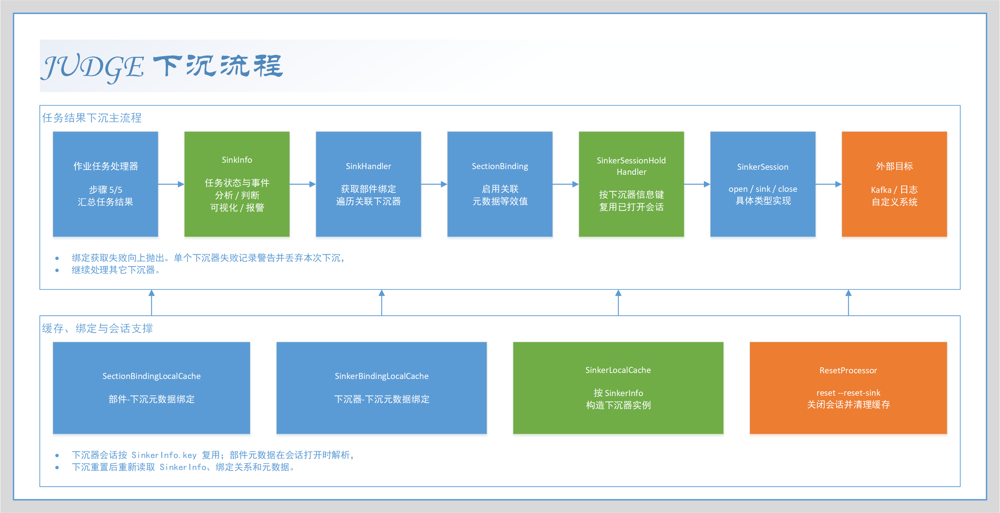

# Sinker - 下沉器

## 说明

下沉器用于在 Judge 的任务执行过程中，将一次任务的处理结果推送到外部系统、消息系统或其它结果接收端。

分析器和判断器面向任务内部的数据处理，提供器面向外部数据查询；下沉器则面向任务完成后的结果输出。
下沉器不会参与分析、判断或可视化计算，而是在作业的最后一个处理阶段接收统一的 `SinkInfo`。

Judge 的一次作业通常按以下顺序执行：

1. 分析：执行部件下配置的分析器，产生 `Analysis`。
2. 判断：执行判断器，产生 `Judgement`。
3. 可视化：生成 `VisualizeData`。
4. 报警：生成报警模态和相关任务信息。
5. 下沉：汇总任务信息、任务事件、分析结果、判断结果、可视化数据和报警模态，并交给部件绑定的下沉器。



下沉器由 `SinkerInfo` 描述可复用的下沉器实例，由 `SinkerRelation` 将下沉器实例关联到部件，
并通过 `SinkerMeta` 保存同一下沉器在不同部件上的差异化配置。
因此，一个下沉器实例可以被多个部件复用，而每个部件可以为该实例提供不同的主题、分区或其它运行参数。

本文介绍下沉器的信息实体、接口、生命周期、绑定缓存、会话复用和异常行为；
项目内置的具体实现请参阅 [Preset Sinker Implements](./PresetSinkerImplements.md)。

## SinkerInfo

`SinkerInfo` 描述节点上的一个下沉器运行实例，关键字段如下：

| 字段      | 类型        | 说明                                                           |
|-----------|-------------|----------------------------------------------------------------|
| `key`     | `LongIdKey` | 下沉器信息主键。                                               |
| `enabled` | `boolean`   | 是否启用；未启用的下沉器不会进入下沉器本地缓存和绑定执行链路。 |
| `type`    | `String`    | 下沉器类型标识，用于匹配对应的 `SinkerMaker`。                 |
| `param`   | `String`    | 下沉器构造参数，具体格式由下沉器类型决定。                     |
| `remark`  | `String`    | 备注。                                                         |

`SinkerInfo` 本身不包含部件主键。下沉器与部件之间通过 `SinkerRelation` 建立多对多关系，
同一个 `SinkerInfo` 可以关联多个部件。

系统根据 `type` 选择制造器，再使用 `param` 构造 `Sinker`。如果没有制造器支持该类型，
或者参数无法被对应实现解析，构造过程会失败。

## SinkerMeta

`SinkerMeta` 保存下沉器在某个部件上的关联元数据。其复合主键由以下部分组成：

| 主键字段          | 类型     | 说明                           |
|-------------------|----------|--------------------------------|
| `sectionLongId`   | `Long`   | 元数据所属部件的长整型主键。   |
| `sinkerLongId`    | `Long`   | 元数据所属下沉器的长整型主键。 |
| `metaStringId`    | `String` | 下沉器实现约定的元数据标识。   |

实体字段如下：

| 字段     | 类型            | 说明                                     |
|----------|-----------------|------------------------------------------|
| `key`    | `SinkerMetaKey` | 部件、下沉器和元数据标识组成的复合主键。 |
| `value`  | `String`        | 元数据值，由具体下沉器解析。             |
| `remark` | `String`        | 备注。                                   |

下沉器类型通过 `SinkerSupporter.provideIndicatorMap()` 声明元数据指示器。
每个指示器包含显示标签、默认值和描述，并按下沉器类型保存为 `SinkerMetaIndicator`。

下沉器读取绑定信息时使用 `SinkerMetaInfo`：

| 属性              | 说明                                                         |
|-------------------|--------------------------------------------------------------|
| `metaValue`       | 部件上实际保存的元数据值；不存在时为 `null`。                |
| `defaultValue`    | 类型指示器声明的默认值；不存在指示器时为 `null`。            |
| `equivalentValue` | 实际值不为 `null` 时取实际值，否则取默认值。                 |

因此，具体下沉器通常应读取 `equivalentValue`。支持信息重置只更新类型及其指示器定义，
不会替部件创建绑定关系；元数据的补全和重置由元数据操作处理器完成。

## SinkerVariable

`SinkerVariable` 用于保存下沉器跨任务维护的小型状态。

变量的复合主键由下沉器信息主键和变量字符串标识组成：

| 字段                 | 类型     | 说明                             |
|----------------------|----------|----------------------------------|
| `sinkerInfoLongId`   | `Long`   | 变量所属的下沉器信息主键。       |
| `variableStringId`   | `String` | 下沉器内部约定的变量字符串标识。 |

变量实体的关键字段如下：

| 字段           | 类型                | 说明                 |
|----------------|---------------------|----------------------|
| `key`          | `SinkerVariableKey` | 下沉器变量复合主键。 |
| `valueType`    | `int`               | 变量值类型。         |
| `stringValue`  | `String`            | 字符串值。           |
| `longValue`    | `Long`              | 长整型值。           |
| `doubleValue`  | `Double`            | 双精度浮点值。       |
| `booleanValue` | `Boolean`           | 布尔值。             |
| `dateValue`    | `Date`              | 日期值。             |

变量值类型与有效值字段的对应关系如下：

| 类型常量                      | 枚举值 | 有效字段       |
|-------------------------------|--------|----------------|
| `VARIABLE_VALUE_TYPE_STRING`  | `0`    | `stringValue`  |
| `VARIABLE_VALUE_TYPE_LONG`    | `1`    | `longValue`    |
| `VARIABLE_VALUE_TYPE_DOUBLE`  | `2`    | `doubleValue`  |
| `VARIABLE_VALUE_TYPE_BOOLEAN` | `3`    | `booleanValue` |
| `VARIABLE_VALUE_TYPE_DATE`    | `4`    | `dateValue`    |

变量归属于 `SinkerInfo`，不归属于某一次任务。下沉器可以用它保存发送游标、外部系统偏移量、
连续失败次数或其它需要跨任务延续的状态。一次任务的输出应写入外部系统或由下沉器自行处理，
不应将 `SinkerVariable` 当作任务结果集合。

## 接口

### Sinker

下沉器 `Sinker` 是创建下沉器会话的入口，主要方法如下：

| 方法签名                                            | 说明                     |
|-----------------------------------------------------|--------------------------|
| `SinkerSession newSession() throws SinkerException` | 创建一个新的下沉器会话。 |

具体实现通常继承 SDK 中的 `AbstractSinker`，在 `doNewSession()` 中创建会话实例。
`Sinker` 适合保存由 `SinkerInfo.param` 解析得到的只读配置，例如目标地址、主题名称或序列化规则。

下沉器实例进入下沉器本地缓存，并可以为多个部件和多个任务创建会话。
如果实现保存了可变状态，应自行保证并发访问的线程安全性。

### SinkerSession

`SinkerSession` 表示一个可打开、可关闭并执行下沉操作的会话，主要方法如下：

| 方法签名                                                 | 说明                         |
|----------------------------------------------------------|------------------------------|
| `void init(Context context)`                             | 设置下沉器会话上下文。       |
| `void openSession() throws SinkerSessionException`       | 打开外部连接或准备运行资源。 |
| `void sink(SinkInfo info) throws SinkerSessionException` | 下沉一次任务结果。           |
| `void closeSession() throws SinkerSessionException`      | 关闭会话并释放运行资源。     |

SDK 中的 `AbstractSinkerSession` 对打开、关闭和下沉方法提供异常包装模板，并保存上下文。
会话通常由系统复用，而不是每次任务都重新创建。

### Context

`SinkerSession.Context` 表示下沉器会话运行时的上下文。上下文提供的主要能力如下：

| 能力           | 相关方法                                                             | 说明                               |
|----------------|----------------------------------------------------------------------|------------------------------------|
| 获取当前对象   | `getSinkerInfoKey()`                                                 | 获取当前下沉器信息主键。           |
| 读取部件绑定   | `getSectionBinding(LongIdKey sectionKey)`                            | 获取部件到下沉器元数据的绑定信息。 |
| 读取下沉器绑定 | `getSinkerBinding(LongIdKey sinkerKey)`                              | 获取下沉器关联的全部部件绑定信息。 |
| 维护下沉器变量 | `inspectVariable(...)`、`upsertVariable(...)`、`removeVariable(...)` | 读取、写入和删除下沉器状态。       |

绑定对象是缓存结果，调用方不能直接修改返回的 `SectionBinding` 或 `SinkerBinding`。
如果实现需要调整数据，应复制后再处理。

### SinkerMaker

`SinkerMaker` 根据下沉器类型和参数构造下沉器，主要方法如下：

| 方法签名                                                              | 说明                   |
|-----------------------------------------------------------------------|------------------------|
| `boolean supportType(String type)`                                    | 判断是否支持指定类型。 |
| `Sinker makeSinker(String type, String param) throws SinkerException` | 构造下沉器实例。       |

系统依次检查 Spring 容器中的制造器，并使用第一个支持指定类型的制造器。
制造器应在构造阶段完成参数解析、参数校验以及不依赖任务数据的资源准备。

### SinkerSupporter

`SinkerSupporter` 用于描述一个下沉器类型，主要方法如下：

| 方法签名                                                  | 说明                 |
|-----------------------------------------------------------|----------------------|
| `String provideType()`                                    | 提供下沉器类型标识。 |
| `String provideLabel()`                                   | 提供显示名称。       |
| `String provideDescription()`                             | 提供类型说明。       |
| `String provideExampleParam()`                            | 提供示例构造参数。   |
| `Map<String, IndicatorProvideInfo> provideIndicatorMap()` | 提供元数据指示器。   |

SDK 中的 `AbstractSinkerRegistry` 同时实现 `SinkerMaker` 和 `SinkerSupporter`，
适合用于注册一个固定类型的下沉器。

## 下沉器的生命周期

### 构造

系统读取一个启用的 `SinkerInfo` 时，根据其 `type` 查找支持该类型的 `SinkerMaker`，
再将 `type` 和 `param` 传递给制造器构造 `Sinker`。

构造完成的下沉器以 `SinkerInfo.key` 为键保存到下沉器本地缓存。
参数解析、连接配置解析和不可变发送规则通常应在此阶段完成，避免在每次下沉时重复处理。

如果没有制造器支持指定类型，系统抛出 `UnsupportedSinkerTypeException`；
如果参数解析或实例构造失败，系统抛出下沉器制造异常。

### 建立会话

部件绑定缓存只包含启用部件、启用关联和启用下沉器信息对应的下沉器。
下沉处理器按照绑定缓存中的下沉器信息主键取得会话。

会话持有处理器以 `SinkerInfo.key` 为键复用会话。首次取得时，系统从本地缓存取得 `Sinker`，
调用 `newSession()`，创建上下文，依次调用 `init(context)` 和 `openSession()`；
只有打开成功后，会话才会放入持有映射。

相同下沉器信息在多个任务中使用同一个会话，因此会话实现必须正确处理并发下沉。
部件差异化配置通过上下文读取 `SectionBinding` 或 `SinkerBinding`，不应写入下沉器实例的全局可变字段。

### 执行下沉

作业处理器在第 5/5 步创建 `SinkInfo`，其中包含当前部件和任务的状态信息，以及任务事件、分析结果、判断结果、
可视化数据和报警模态。随后调用 `SinkHandler.sink(SinkInfo)`。

`SinkHandler` 读取当前部件的 `SectionBinding`，遍历其中的下沉器信息主键，
为每个下沉器取得会话并调用一次 `SinkerSession.sink(info)`。
框架不为下沉器规定固定的外部协议；目标系统的编码、事务、幂等和重试策略由具体实现负责。

同一次作业的 `SinkInfo` 会传递给当前部件绑定的每一个下沉器。下沉器之间没有框架级的先后依赖，
也没有跨下沉器的整体事务。

`SinkInfo` 的顶层内容如下：

| 内容             | 说明                                                                   |
|------------------|------------------------------------------------------------------------|
| 部件与任务标识   | `sectionKey`、`taskKey`、部件名称和备注。                              |
| 任务状态         | 状态、创建/开始/结束时间、持续时间、过期和死亡时间、锚点消息。         |
| `taskEvents`     | 任务事件的发生时间和消息。                                             |
| `analyses`       | 分析结果标识、数据类型和类型对应的值；值可以是简单值、图片或文件对象。 |
| `judgements`     | 判断结果标识、范围为 `[0.0, 1.0]` 的判断值和判断消息。                 |
| `visualizeDatas` | 视角字符串标识和可视化内容。                                           |
| `alarmModals`    | 报警标识、是否报警、发生时间、类型、判断值及消息。                     |

任务处理器会在调用下沉器前收集这些内容，因此下沉器只负责消费 `SinkInfo`，不需要再次查询任务结果。

### 关闭会话

系统执行下沉重置时，先停止接收处理器，再关闭并清理全部下沉器会话，随后清除下沉器本地缓存、部件绑定缓存和下沉器绑定缓存，
最后恢复此前已启动的接收处理器，并通知推送处理器执行下沉重置。

关闭过程会逐个调用会话的 `closeSession()`。单个会话关闭失败会记录日志，但不会阻止其它会话关闭；
所有会话处理结束后，系统清空会话持有映射。

下沉器接口没有按任务调用的关闭回调。需要长期持有连接、线程或事务资源的实现，应在 `closeSession()` 中释放，
并保证重复重置后可以重新打开。

## 工作机制

### 部件绑定与元数据

`SinkerRelation` 的复合主键由部件长整型主键和下沉器长整型主键组成，`enabled` 控制关联是否生效。
生成部件绑定时，同时要求关联启用、部件启用以及下沉器信息启用；任一条件不满足，该关联不会进入绑定缓存。

部件绑定缓存 `SectionBinding` 的逻辑结构为：

```text
Map<sinkerInfoKey, Map<metaStringId, SinkerMetaInfo>>
```

下沉器绑定缓存 `SinkerBinding` 使用反向结构：

```text
Map<sectionKey, Map<metaStringId, SinkerMetaInfo>>
```

实现可以通过 `SectionBinding` 在下沉时读取当前部件配置，也可以通过 `SinkerBinding` 在打开会话时一次性读取该下沉器关联的全部部件配置。

### 本地缓存与会话持有

下沉机制使用三类与下沉相关的缓存：

| 缓存                       | 键或内容                         | 作用                                     |
|----------------------------|----------------------------------|------------------------------------------|
| `SinkerLocalCache`         | `SinkerInfo.key -> Sinker`       | 保存已启用下沉器的构造实例。             |
| `SectionBindingLocalCache` | `sectionKey -> SectionBinding`   | 保存部件关联的下沉器及其元数据。         |
| `SinkerBindingLocalCache`  | `sinkerInfoKey -> SinkerBinding` | 保存某个下沉器关联的全部部件及其元数据。 |
| `SinkerSessionHold`        | `sinkerInfoKey -> SinkerSession` | 保存已初始化并成功打开的会话。           |

修改 `SinkerInfo.type`、`param`、`enabled`、关联关系或关联元数据后，已有缓存不会自动按本次修改立即重建。
应根据变更内容清理下沉器缓存、绑定缓存和会话，确保后续任务读取新配置。

### 元数据操作

下沉器元数据操作支持查看、补全和重置：

| 操作       | 行为                                                         |
|------------|--------------------------------------------------------------|
| `inspect`  | 合并实际元数据和类型指示器，返回实际值、默认值及等效值。     |
| `complete` | 仅为缺少的指示器插入默认元数据，不覆盖已有元数据。           |
| `reset`    | 删除指定部件与下沉器的全部元数据，再按当前指示器插入默认值。 |

补全和重置依赖当前已持久化的 `SinkerMetaIndicator`。执行 `support --reset-sinker` 后，
支持信息和指示器来自当前加载的 `SinkerSupporter`；执行元数据补全或重置前，应确认目标下沉器类型已经正确加载。

### 下沉结果格式

下沉器接收的是 Java 对象 `SinkInfo`，不是固定的字符串格式。
例如 NativeKafkaSinker 会使用 `FastJsonSinkInfo.of(info)` 将其转换为 JSON；其它下沉器可以使用不同的序列化方式，
但应保持任务标识、状态和结果数据的语义一致。

分析结果中的图片、图片包、文件和文件包通常以结果元数据和对象引用的形式出现在 `SinkInfo` 中，
并不等价于自动将二进制内容嵌入消息。目标系统若需要下载原始内容，应根据相应结果信息访问文件或图片服务。

### 异常处理

下沉器机制区分构造、会话和执行阶段的异常：

| 异常或行为                       | 说明                                                               |
|----------------------------------|--------------------------------------------------------------------|
| `UnsupportedSinkerTypeException` | 没有制造器支持指定的下沉器类型。                                   |
| `SinkerMakeException`            | 下沉器参数解析或实例构造失败。                                     |
| `SinkerSessionException`         | 创建、打开、关闭或执行会话时发生的下沉器会话异常。                 |
| 单个会话下沉失败                 | `SinkHandler` 记录警告并丢弃本次该下沉器下沉，继续处理其它下沉器。 |
| 部件绑定获取失败                 | 无法取得下沉器遍历范围时向上抛出，作业下沉阶段可能因此失败。       |

当前 `SinkHandler` 不提供框架级重试、补偿或消息持久化。实现需要自行决定发送失败后的处理方式；
下沉器内部已经完成的外部副作用也不会因为另一个下沉器失败而自动回滚。

## 运维与配置

下沉器扩展通过 `opt/opt-sinker.xml` 加载。发行包中的预设下沉器组件扫描配置默认被注释，
启用对应实现时需要取消相应 `context:component-scan` 的注释，并重启节点使 Spring 加载注册器。
Kafka 原生下沉器还需要配置 `opt/opt-sinker-kafka-native.xml` 中的 Kafka Producer、`KafkaTemplate` 和事务管理器 Bean。
具体目录配置请参阅 [Opt Directory](./OptDirectory.md)。

Telqos 中与下沉器相关的常用命令如下：

| 命令                       | 说明                                                                |
|----------------------------|---------------------------------------------------------------------|
| `slc -l <sinker-info-id>`  | 查看指定下沉器信息的下沉器本地缓存。                                |
| `slc -c`                   | 清除全部下沉器本地缓存。                                            |
| `sblc -l <sinker-info-id>` | 查看指定下沉器信息的下沉器绑定缓存。                                |
| `sblc -c`                  | 清除全部下沉器绑定缓存。                                            |
| `ss -l <sinker-info-id>`   | 查看指定下沉器信息的会话持有情况。                                  |
| `ss -cnc`                  | 关闭并清除全部下沉器会话。                                          |
| `support --reset-sinker`   | 根据当前加载的 `SinkerSupporter` 重置下沉器支持信息和元数据指示器。 |
| `reset --reset-sink`       | 停止接收处理器，关闭会话，清理下沉相关缓存后恢复运行。              |

`support --reset-sinker` 只更新支持信息和指示器，不会替部件建立下沉器关联，也不会自动重建已有会话。
修改下沉器参数、关联状态或元数据后，建议执行完整的下沉重置，再通过 `slc`、`sblc` 和 `ss` 检查缓存及会话状态。

排查下沉器问题时，可以依次确认：

1. `opt-sinker.xml` 是否加载了目标下沉器实现。
2. `SinkerSupport` 中是否存在对应类型和指示器。
3. `SinkerInfo` 是否存在、已启用，且 `type` 和 `param` 合法。
4. 部件是否启用，`SinkerRelation` 是否启用，关联元数据是否完成。
5. `slc` 和 `sblc` 是否能够构造出期望的实例和绑定。
6. `ss` 是否显示会话已成功打开，目标系统是否收到对应消息。
7. 若仅有一个目标失败，检查下沉器警告日志；框架会丢弃该次失败下沉，不会自动补发。

## 参阅

- [Preset Sinker Implements](./PresetSinkerImplements.md) - 预设下沉器实现，详细说明本项目内置的下沉器。
- [Analyser](./Analyser.md) - 分析器，说明下沉前的分析阶段。
- [Judger](./Judger.md) - 判断器，说明下沉前的判断阶段。
- [Provider](./Provider.md) - 提供器，说明统一外部查询机制。
- [Opt Directory](./OptDirectory.md) - 可选配置目录，说明下沉器扩展及 Kafka 配置文件。
- [Telqos Commands](./TelqosCommands.md) - Telqos 命令，说明缓存、会话和重置命令。
